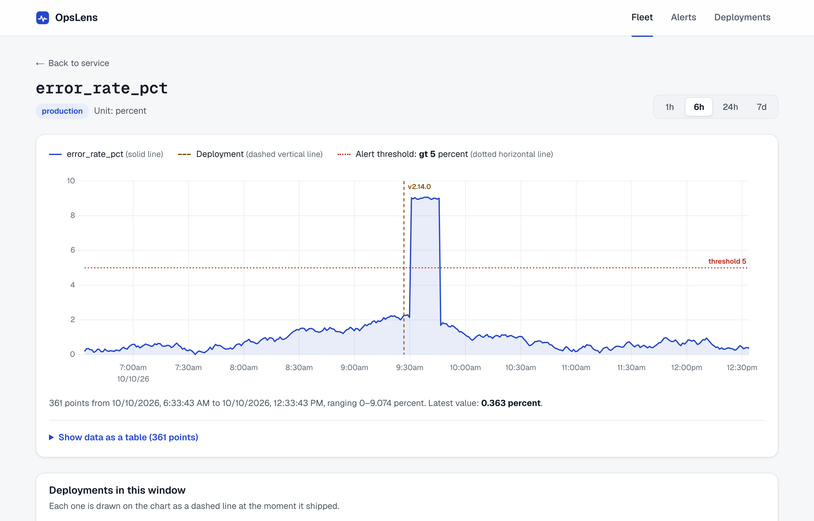
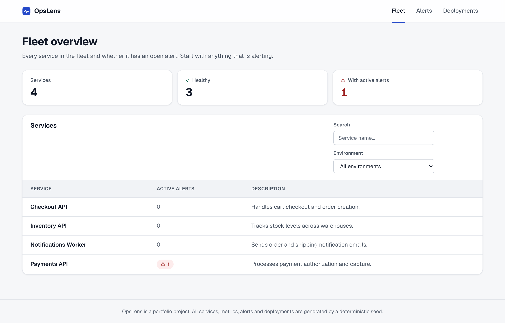
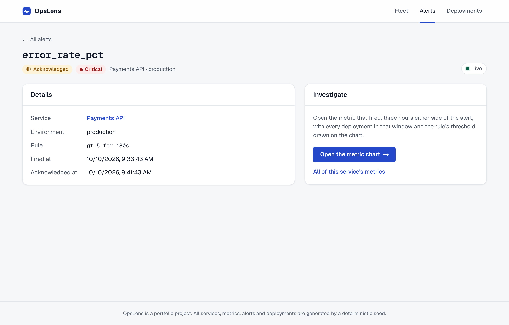

# OpsLens: case study

## The problem

A small platform team gets an alert. The first question is almost always the
same: did something we shipped cause this? Answering it usually means four
browser tabs: the alerting tool, a metrics dashboard, the deploy log, and the
service catalogue, lined up by hand on timestamps.

OpsLens answers that one question for a small fleet. It shows which service
is in trouble, the metric that crossed its threshold in a given environment,
and the deployments in the same window, drawn on the same chart. It is
deliberately not a general observability platform: no log search, no
tracing, no query language, no multi-tenant auth.

## The demo path

The seed builds one deterministic scenario every time it runs. Payments API's
error rate in production jumps from about 2% to about 9% a few minutes after
`v2.14.0` ships, crosses the alert's `> 5%` rule, and an alert opens.

1. **Fleet overview.** Four services; Payments API is the one with an active alert.
2. **Service detail.** Its metrics, each with the environments it has data in.
3. **Metric chart.** `error_rate_pct` in production: the spike, a dashed marker labelled `v2.14.0` just before it, and the threshold as a dotted line.
4. **Alert detail.** The rule (`gt 5 for 180s`), when it fired, and a link back to the chart centred on the alert.

The walk is also the main Playwright test, run once with the mouse and once
keyboard-only.

| Fleet overview | Alert detail |
| --- | --- |
|  |  |

## Decisions, and what was rejected

Each of these is written up in full in [`docs/spec/`](spec/00-overview.md),
the planning blueprint written before most of the code.

**Fastify over NestJS.** Five resources with no cross-module dependencies
do not need a DI container. A `routes → SQL` layout per module, with
`eslint-plugin-boundaries` stopping modules from importing each other, gives
the same separation with less to explain.

**Raw SQL with `pg` and `node-pg-migrate` over an ORM.** The interesting
queries (the open-alert dedup index, time-bounded point reads, pagination
with an explicit sort allowlist) are easier to review, `EXPLAIN`, and
defend as SQL than as ORM calls.

**One set of zod schemas for both apps.** `@opslens/shared-types` holds the
wire contracts. Fastify validates requests and responses with them, and the
web client parses every response with the same schemas. Adding `metricId` to
the alert detail this phase meant editing the schema first; the compiler then
pointed at every place that needed to change.

**uPlot over ECharts or Recharts.** The only chart is a time series of at
most 1,000 points. uPlot is small and canvas-based, and it is updated
imperatively. The chart component creates its instance once and only ever
calls `setData`/`redraw` afterwards. A regression test fails if the
constructor runs a second time.

**A hand-rolled `useApiResource` over TanStack Query.** Every screen has the
same four states: loading, error with retry, empty with a reason, and ready.
Writing that state machine once, and testing it, was the point. A query
cache would have hidden it.

**Server-Sent Events over WebSockets.** Updates only flow from server to
browser. SSE gives reconnection for free and needs no extra protocol.

**URL search params as filter state.** An investigation is a link: the
environment, filters, and time range all survive a refresh and can be
pasted into a ticket.

**CSS Modules and design tokens, no component library.** The visual layer is
one token set in `globals.css` with a separate dark-mode block, and six small
layout primitives (`PageHeader`, `Panel`, `StatTile`, `LiveIndicator`,
`NavLink`, `DataTable`). The chart reads the same tokens, so it follows the
theme.

## Evidence

Everything below comes from a run that actually happened. Method and machine
are recorded in the linked reports.

**Performance** ([report](performance-report.md)).
- The services environment filter does a full `metric_points` scan: 6.0 ms
  at the real 13,840 rows, 64.7 ms at 10x, 223.5 ms at 100x. It was left
  alone, because 6 ms is not a problem at this scale. The fix it would
  justify is recorded for when it becomes one.
- In a production build, the 58.5 KB (uncompressed) uPlot chunk loads on the
  metric chart route and on none of the other five.
- Table virtualisation was not added: every list endpoint caps pages at 100
  rows, so there is nothing for it to solve.

**Accessibility** ([report](accessibility-report.md)).
- Two automated checks run in CI: a keyboard-only Playwright pass through
  the demo path, and axe scans (WCAG 2 A/AA rules) of all six screens in both
  light and dark mode.
- The chart has a text summary and an opt-in data table. Every status badge
  pairs its color with an icon and a word.
- Live updates are announced through a throttled, polite live region.
- No conformance claim is made, and no screen-reader session was run.

**Bugs that tests or measurement found, not users.**
- *CORS on the SSE stream.* The realtime route hijacks the socket, which
  skips Fastify's CORS hook, so every cross-origin browser connection failed
  and retried forever. The reconnection E2E test found it. `app.inject()`
  can't reproduce it, so the regression test runs a real listening server.
- *A shared-database race in the integration suite.* Two test files
  truncated and re-seeded the same database in parallel. A probe reproduced
  it 140 times in 300, and running the suite serially fixed it.
- *The demo alert resolved itself.* The seed inserted the alert as
  "firing", but the spike had ended hours before seed time. A minute after
  the API started, the evaluator correctly resolved it, and the last step of
  the demo showed "resolved". E2E never noticed, because the suite finishes
  inside that first minute. The alert is now seeded as acknowledged, which
  the evaluator by design never auto-resolves.
- *The "24h" chart showed 8 hours.* The client never passed `limit`, so
  the API's default of 500 points applied. The chart now requests the
  maximum and says so in text when a window is still larger than one
  request returns.

## Where the build diverged from the plan

The spec is frozen as written, so these differences stay visible on purpose.

- **The SSE stream carries alert status changes, not metric points.** The
  plan had new points pushed into open charts. In the build, REST stays the
  source of truth and the stream only says "this alert changed". The client
  refetches what that affects. That is fewer moving parts, and an event that
  arrives out of order is fixed by the next fetch.
- **Local Postgres runs on Homebrew, not Docker.** Docker did not run on
  the development machine. `docker-compose.yml` is kept as the reference,
  and CI uses the same `postgres:16-alpine` image.
- **The seeded alert is acknowledged, not firing**, for the reason above.

## Limits, stated plainly

- **All data is seeded.** Nothing ingests real metrics. After seeding, the
  time series stops growing, so the newest point gets older the longer the
  API runs.
- **One request is 1,000 points.** At production's one-point-per-minute
  cadence, that is about 16 hours. Longer windows show their most recent
  part, with a notice. Server-side downsampling is the real fix and was not
  built.
- **Single-process evaluator.** Alert evaluation is a `setInterval` in the
  API process, with no coordination between instances.
- **Read-mostly.** There is no write UI: alerts can't be acknowledged from
  the browser, and rules can't be edited.
- **No auth**, by scope.

At real scale, the first things to change would be the services filter
query (the measurement above already shows the trend), ingestion and
downsampling for `metric_points`, and moving the evaluator out of the API
process.
